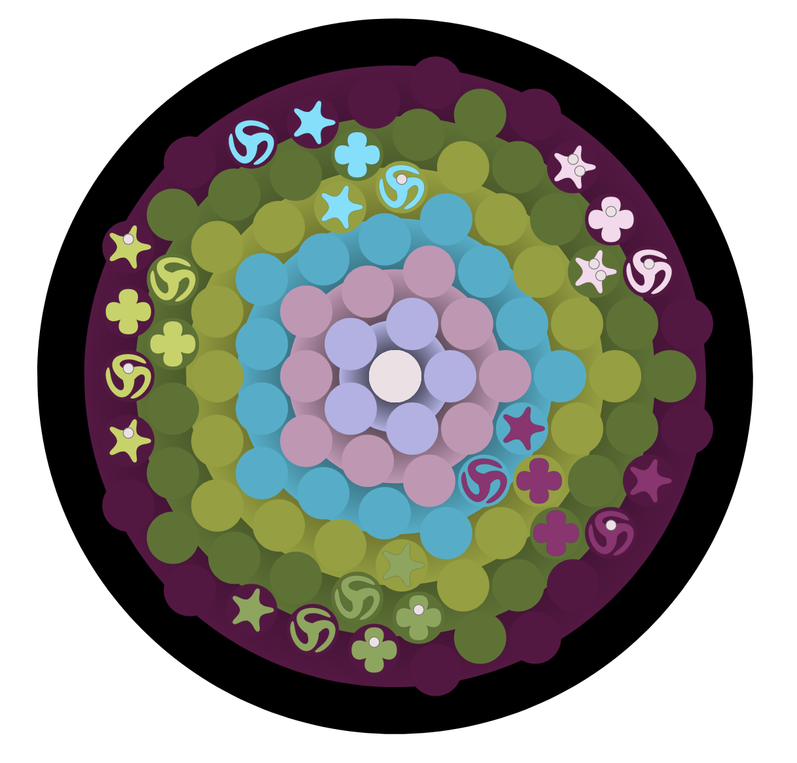

# organism

A server for synchronous and asynchronous play of ORGANISM, the board game.

An instance is currently running at https://playorganism.io/

## Prerequisites

- [Leiningen][1] 2.0+
- Node.js / npm (for shadow-cljs)
- MongoDB running locally on the default port

[1]: https://github.com/technomancy/leiningen

## Local development

Create a `dev-config.edn` in the project root (gitignored):

    {:dev true
     :port 3000
     :nrepl-port 7000}

Install JS deps once:

    npm install

Then run two processes in parallel:

1. **ClojureScript build (hot-reload):**

        npx shadow-cljs watch organism journey oroboros eridu future universe distinctions

2. **Clojure server:**

        lein run

The server listens on `http://localhost:3000` and starts an nREPL on `7000`. Shadow writes compiled JS into `resources/public/js/`, which the server serves directly.

## Playtest table

`/table` is an open 3D table for playtesting: every game's components (organism's pieces and
boards, the UNIVERSE and DISTINCTIONS decks), playing cards, cubes, meeples, dice, and blank boards
you can draw on. Drop images or STL/GLB/OBJ files onto it to bring in new components. Press `H` there
for the controls. Signed-in players make shared tables and invite others by link; `/table/solo` is a
table kept only in the browser. The client is `src/cljs/table/` (the `table` shadow-cljs build); the
server is `routes/table.clj`, `routes/table_ws.clj` and `persist_table.clj`; both sides apply changes
through `src/cljc/table/patch.cljc`.

Its library of game components is generated: `make` in `table/` shrinks each game's printed art
(`universe/out/mpc`, `distinctions/out/mpc`, `pieces/tts/out/assets`) into
`resources/public/table/`. Run it again after any of those change.

## Production build

    npx shadow-cljs release organism journey oroboros eridu future universe distinctions table
    lein uberjar

The uberjar at `target/uberjar/organism.jar` includes the release JS bundle.

## License

Copyright © 2021 Ryan Spangler
